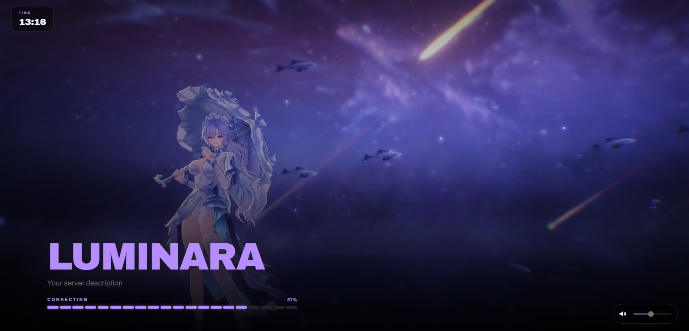

# Project07 Loading Screen (Just A Simple Loading Screen)

A lightweight, customizable FiveM loading screen with a segmented loading bar, live clock, background video, and volume controls.



## Features

- FiveM loading progress displayed as a segmented bar and percentage.
- Simulated progress when opened outside the FiveM loading screen.
- Background video with a responsive dark overlay.
- Live 24-hour clock and audio mute/volume controls.
- Loading-screen fade-out and shutdown handoff to the Lua client script.
- Responsive layout for different screen sizes.

## Installation

1. Copy this resource folder into your FiveM server's `resources` directory.
2. Add a background video at `web/assets/video.mp4`. The resource references this path in both `fxmanifest.lua` and the loading page.
3. Add the resource to `server.cfg`, using the folder name if you rename it:

   ```cfg
   ensure Project07_LoadingScreen
   ```

4. Restart the server or start the resource.

## Customization

- Edit the title and subtitle in `web/ui/index.html`.
- Change colors, typography, spacing, and responsive styles in `web/ui/style.css`.
- Adjust the preview progress simulation and default volume in the `CFG` object in `web/ui/script.js`.
- Replace `web/assets/video.mp4` with your own background video.

The progress simulation is only a fallback for browser previews. In FiveM, the screen uses the loading progress messages supplied by the game.
